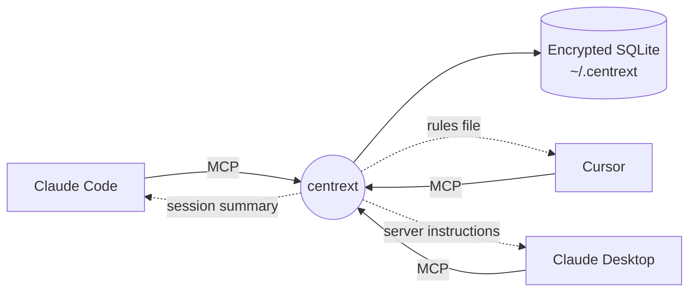

<div align="center">

<picture>
  <source media="(prefers-color-scheme: dark)" srcset="assets/logo-dark.svg">
  
</picture>

# Centrext

**One shared, governed memory for all your AI tools.**

Explain something once to Claude Code. Cursor and Claude Desktop already know it.


[Quick start](#-quick-start) · [Connect](#-connect-your-ai-tools) · [How it works](#-how-it-works) · [Trust](#-trust-and-review) · [Search](#-search) · [CLI](#-cli) · [Security](#-security)

</div>

---

## ✨ Why

Every AI tool keeps its own memory, so you repeat yourself, decisions get lost, and agents work from different assumptions.

Centrext is one local store that every connected agent reads from and writes to, with rules about who may change what. A `CLAUDE.md` file is shared too, so here is what Centrext adds:

| | Markdown file in the repo | Centrext |
|---|---|---|
| **Clients** | Each tool reads its own file | Claude Code, Cursor and Claude Desktop share one store |
| **Plain chats** | No repo, no file | Your Personal namespace follows you |
| **Trust** | Every line looks equally true | Verified, session-confirmed and agent-noticed are kept apart |
| **History** | Git history of one file | Immutable revisions, with the agent that wrote each one |
| **Access** | Anyone with the file | One revocable token per client, scoped to namespaces |

## 🚀 Quick start

Requires Go 1.26 or newer. No C toolchain is needed, because SQLite is pure Go and encrypted.

```bash
git clone https://github.com/RHL-RWT-01/Centrext.git && cd Centrext && go install ./cmd/centrext
```

Create your encrypted store:

```bash
centrext init
```

Then [connect your AI tools](#-connect-your-ai-tools), and check the setup:

```bash
centrext doctor
```

Start a new session and say *"remember that orders live in PostgreSQL"*. Open another tool and ask which database to use.

## 🔌 Connect your AI tools

Every tool talks to Centrext over [MCP](https://modelcontextprotocol.io) as its own agent, with its own revocable token. Tokens stay in your OS keychain, and configs only ever name the client.

| Tool | Command | What it sets up |
|---|---|---|
| **Claude Code** | `centrext connect claude-code` | MCP server for all projects, plus a session-start hook that adds the project summary |
| **Cursor** | `centrext connect cursor` *(inside each project)* | `.cursor/mcp.json` and a rules file Centrext keeps current (it's git-ignored) |
| **Claude Desktop** | `centrext connect claude-desktop` | MCP server in Claude Desktop's config. Chats use your Personal namespace |
| **Any other MCP client** | `centrext connect NAME --manual` | Registers the agent and prints the config to paste |

Restart the tool afterwards. Running `connect` again repairs the setup and reuses the same agent.

### Claude Code

```bash
centrext connect claude-code
```

This needs the `claude` CLI on your PATH; if it's missing, Centrext prints the command to run. Optionally, let Centrext add the most relevant saved item to each prompt. The matching happens on your machine:

```bash
centrext connect claude-code --prompt-context on
```

### Cursor

Cursor is set up per project, so run this inside each one, or pass `--dir`:

```bash
centrext connect cursor
```

### Claude Desktop

```bash
centrext connect claude-desktop
```

Quit Claude Desktop completely (including from the menu bar) and reopen it.

### Other MCP clients

Windsurf, VS Code, Codex, Gemini CLI, Zed and other MCP clients connect by hand. Pick a short name for the tool:

```bash
centrext connect windsurf --manual
```

Centrext prints a config like this. It never contains a token:

```json
{
  "mcpServers": {
    "centrext": {
      "command": "/Users/you/go/bin/centrext",
      "args": ["mcp", "--client", "windsurf"]
    }
  }
}
```

Paste it where your tool reads MCP servers. Use the printed `command` path, and add `"--workspace", "<project folder>"` to `args` if the tool can pass its project folder.

<details>
<summary>Where common tools keep their MCP config</summary>

<br/>

| Tool | File | Format |
|---|---|---|
| Windsurf | `~/.codeium/windsurf/mcp_config.json` | `mcpServers`, as above |
| Gemini CLI | `~/.gemini/settings.json` | `mcpServers`, as above |
| VS Code | `.vscode/mcp.json` | `"servers": { "centrext": { "type": "stdio", "command": …, "args": […] } }` |
| Codex CLI | `~/.codex/config.toml` | `[mcp_servers.centrext]` with `command = "…"` and `args = ["mcp", "--client", "codex"]` |
| Zed | `settings.json` | `"context_servers": { "centrext": { "command": …, "args": […] } }` |

These locations change between versions; if one doesn't work, check the tool's MCP documentation.

</details>

### Disconnect

```bash
centrext disconnect cursor
```

This removes the config Centrext wrote, revokes the agent and deletes its token. Anything the agent proposed stays in `centrext review`.

## 🧭 How it works



1. **Save.** An agent saves something when you say "remember this", or after asking you once a choice is settled.
2. **Govern.** Centrext rejects secrets, sets the trust level from *how* the item arrived (never from what the agent claims), and stores an immutable revision.
3. **Deliver.** Every session starts with a short summary of the project's decisions and conventions. Agents search for more before they pick a schema, an API or a dependency.

Projects are recognized from the git remote, so SSH and HTTPS clones and worktrees share context. Chats without a folder use your Personal namespace.

## 🛡️ Trust and review

| Trust | How an item gets it |
|---|---|
| `user_verified` | You approved it outside the chat, with `centrext review` |
| `session_confirmed` | You asked an agent to remember it, or agreed when it asked |
| `agent_reported` | An agent noticed it without asking. Never in summaries, and expires after 30 days |

Agents can't raise trust, delete context, or change anything you verified. Those actions wait for you:

```bash
centrext review
```

## 🔎 Search

Agents search with `context_search`, and you can use `centrext context search`. Search is full-text by default, ranked by trust, and never returns superseded or deleted items.

<details>
<summary><b>Semantic search</b>: find paraphrases through a hosted embeddings API (optional)</summary>

<br/>

```bash
centrext embeddings enable --provider openai
```

```bash
centrext embeddings key
```

Providers are `openai`, `voyage`, or any `openai-compatible` endpoint (with `--base-url` and `--model`). The key is kept in the keychain; `CENTREXT_EMBEDDINGS_KEY` also works.

Embedding sends text to the provider, so it only covers namespaces whose policy allows content to leave the device. New namespaces are `local_only`, and stay full-text until you opt one in:

```bash
centrext namespace policy NAMESPACE local_primary
```

Vectors are computed during searches, or all at once with `centrext embeddings sync`. If the API is slow or down, search falls back to full-text. Queries that contain secrets are never sent.

</details>

<details>
<summary><b>Per-prompt context</b>: give Claude Code the right decision before it asks (opt-in experiment)</summary>

<br/>

```bash
centrext connect claude-code --prompt-context on
```

Each prompt is matched against saved context **on your machine**, and the best clear match is added to what Claude sees. It's tuned for precision: an item must match several words of the prompt, only reviewed or confirmed items qualify, nothing is repeated within a session, and the prompt is never stored or sent anywhere. Turn it off with `--prompt-context off`.

</details>

## 💻 CLI

| Command | What it does |
|---|---|
| `init` | Create the encrypted store and your Personal namespace |
| `connect` / `disconnect CLIENT` | Set up or remove `claude-code`, `cursor`, `claude-desktop`, or any MCP client with `--manual` |
| `doctor` | Check the store, clients, generated files and repos for leaked tokens |
| `store status / reencrypt` | Show the store's encryption, or upgrade an older store to AES-XTS |
| `review [approve / reject ID]` | Approve or reject what agents proposed |
| `context search / list / show / history / add / verify / delete` | Find and manage saved context |
| `namespace list / create / link / policy` | Manage namespaces, their identities and storage policy |
| `link NAMESPACE` | Pin a repo to a namespace with a `.centrext` file |
| `export` | Write the repo's verified decisions to `.centrext-export/` for teammates |
| `embeddings enable / key / status / sync / disable` | Optional semantic search |
| `stats` | See what gets saved, and how often other agents retrieve and use it |
| `agent register / list / grant / revoke` | Manage agents and their access |
| `mcp`, `hook` | Started by your clients, not by you |

## 🔐 Security

- **Encrypted at rest.** AES-XTS page encryption, with the key in the OS keychain. On machines without a keychain, such as headless Linux and WSL, keys go to files only you can read.
- **Durable.** Every acknowledged write is flushed to disk, including on macOS.
- **No tokens in config files.** Each client's token is kept in the keychain, and configs only say `--client cursor`. Centrext stores only token hashes.
- **Secrets are rejected.** Writes that contain keys, tokens or passwords are refused.
- **Instructions aren't trusted.** Text an agent read can never become trusted memory by itself.
- **Local by default.** New namespaces are `local_only`. Nothing leaves the device until you change a namespace's policy.
- **Limit:** local agent identity gives attribution and revocation. It isn't a boundary against code running as your OS user.

## 📊 Measured, not guessed

Ranking changes are judged on a labeled set in `internal/eval`: 30 items, 60 search queries and 34 prompts. The set is synthetic, so treat these numbers as a baseline.

| | Result |
|---|---|
| Search, all queries | 83% precision@5, 90% recall@5, 0 stale results |
| Search, paraphrased queries | 49% precision@5, 64% recall@5, which is the gap embeddings target |
| Per-prompt context | 93% precision; silent on all 14 prompts with no answer |

## 🗺️ Roadmap

- [x] **0.1 Local runtime:** encrypted store, namespaces, immutable revisions, proposals, agents
- [ ] **0.2 Multi-agent:** MCP server; Claude Code, Cursor and Claude Desktop; `connect`, `doctor` *(built; the real-client hit-rate check is left)*
- [ ] **0.3 Context intelligence:** eval set, hosted embeddings, hybrid ranking, per-prompt context *(in progress)*
- [ ] **0.4 Hybrid sync:** cloud API, shared namespaces, web chat apps
- [ ] **0.5 Enterprise:** org namespaces, RBAC, audit, retention

## 🛠️ Develop

```bash
go test ./...
```

```bash
go test ./internal/eval -v
```

<details>
<summary>Project layout</summary>

```
cmd/centrext              CLI, MCP server and hook entry points
internal/domain           entities, validation, invariants (no I/O)
internal/policy           who may do what; secret detection
internal/application      use cases shared by every transport
internal/retrieval        query building, ranking, token budgets
internal/workspace        project identity from a folder (marker, git)
internal/transport/mcp    MCP tools, resources and prompts
internal/connect          client setup, Cursor rules file, doctor
internal/session          what hooks already delivered in a session
internal/infrastructure   encrypted SQLite, OS keychain, embeddings client
internal/eval             labeled retrieval set and metrics
```

</details>

<details>
<summary>Recording embedding vectors for the eval</summary>

<br/>

Hybrid results are measured with vectors recorded once from a provider and replayed offline. Recording sends only the synthetic eval set:

```bash
CENTREXT_EVAL_RECORD=openai OPENAI_API_KEY=... CENTREXT_EVAL_SWEEP=1 go test ./internal/eval -run Hybrid -v
```

</details>

Data lives in `~/.centrext`. Set `CENTREXT_HOME` to use another folder.
